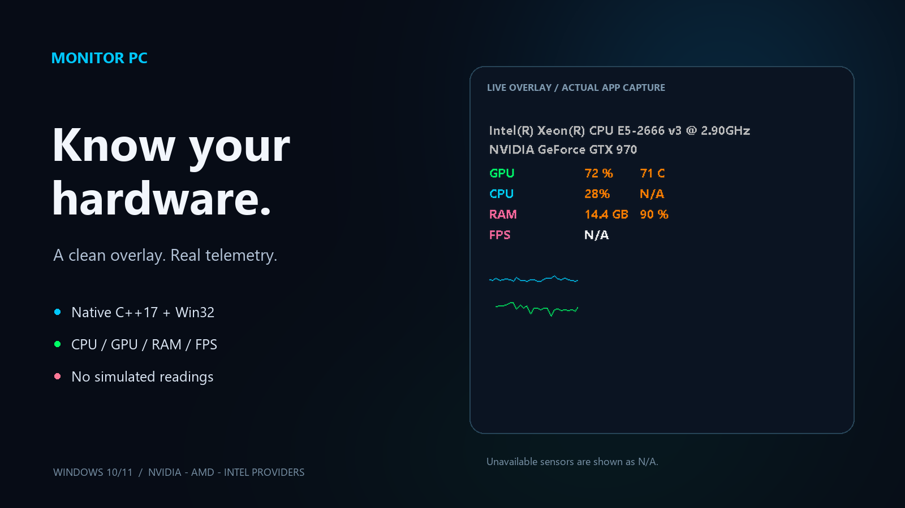
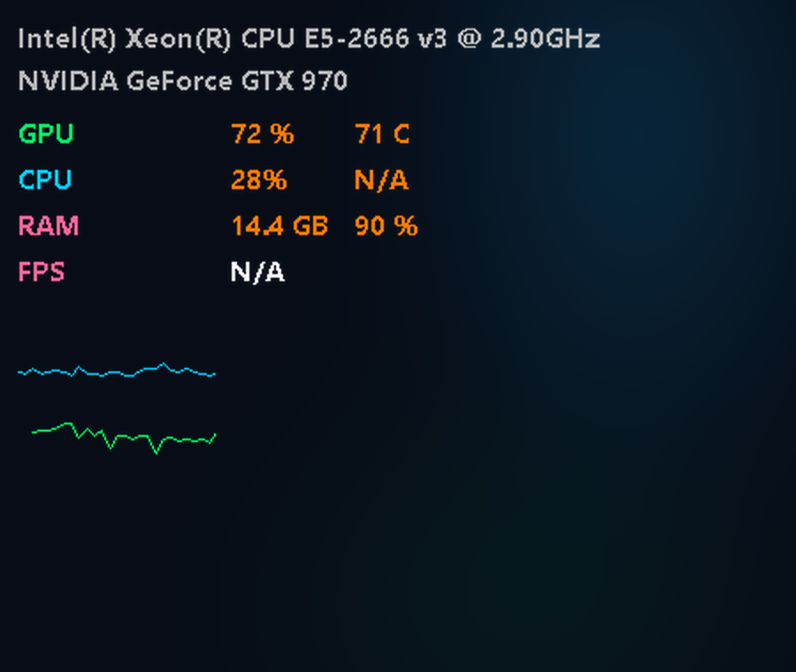

# Monitor PC

**Real hardware telemetry. A clean, floating overlay.**

A Windows hardware overlay built with C++17 and the Win32 API. Colored metrics, two live history graphs, a transparent background, and click-through interaction preserve the original visual design. The telemetry backend has been rebuilt to use measured data and explicit unavailable states.

**No simulated temperatures. No fabricated FPS. Missing readings show `N/A`.**

## What it measures

| Metric | Source | Meaning |
| --- | --- | --- |
| CPU utilization | Windows `GetSystemTimes` | System-wide busy time sampled once per second |
| RAM | Windows `GlobalMemoryStatusEx` | Used physical memory and percentage; displayed GB values are binary GiB |
| GPU utilization | Windows PDH GPU Engine counters + DXGI, with sensor-provider fallback | Busiest engine on the most active detected adapter; provider GPU core load when counters are unavailable |
| CPU temperature | LibreHardwareMonitor helper | Hottest available CPU package/core sensor |
| GPU temperature | LibreHardwareMonitor helper | Core temperature matched by adapter name; unavailable matches stay `N/A` |
| FPS | PresentMon ETW console collector | Present rate of the foreground process, using its fastest active swap chain |
| History | Measured CPU/GPU utilization | Up to 100 one-second samples; unavailable samples leave gaps |

CPU/RAM/GPU load are whole-system readings, not the foreground game's resource consumption. FPS counts application presents, not necessarily frames actually displayed, and is not a generated-frame counter. Switching focus changes the FPS target. The overlay remains visible on the desktop and in compatible windowed/borderless applications.

*Captured from the application's own render surface. Values reflect the capture environment. Presentation backgrounds are added for readability; `N/A` is intentional when a provider cannot return a reading.*

## Download and run

[Download MonitorPC.exe](https://github.com/lordvamp9/Monitor-PC/releases/latest/download/MonitorPC.exe), open it, and approve the Windows permission prompt. The executable contains its collectors and runtime; no installation or separate downloads are required. Windows controls the permission prompt.

The application prepares its components automatically and tracks the foreground application. Right-click the tray icon to exit or view third-party licenses. It cleans up its temporary workspace on normal exit. Incompatible sensors or games show `N/A`; exclusive fullscreen may hide the overlay.

## Build from source

Windows x64, MinGW-w64, PowerShell and .NET 8 SDK are required. Run `./package.ps1` to build and test the single executable at `dist/MonitorPC.exe`. `./package.ps1 -UseExistingCollectors` reuses an existing developer build. The first build downloads the pinned dependencies.

## Hardware compatibility

The application discovers graphics adapters through DXGI rather than assuming a particular registry entry or GPU model. When Windows counters are unavailable, matching GPU core load from the sensor helper is used. Its providers are intended for NVIDIA, AMD, and Intel hardware. On multi-GPU systems the GPU row follows the adapter with the highest measured engine utilization; it does not sum independent adapters together.

**Broad compatibility is the goal, not a guarantee that every sensor exists on every machine.** Some laptops, older graphics drivers, virtual machines, and newer or unsupported devices expose fewer readings. Windows GPU counters require compatible WDDM drivers. CPU time reporting on systems with more than 64 logical processors follows Windows processor-group restrictions of `GetSystemTimes`.

LibreHardwareMonitor may need administrator privileges and a supported low-level sensor driver for CPU temperatures. Windows security policies or another driver can prevent access. Do not disable security features to obtain a reading. If access fails, the overlay continues with `N/A`. GPU core temperature matching is conservative: differing device names can leave a reading unavailable rather than attach a temperature to the wrong GPU.

PresentMon uses ETW instead of injecting this overlay into a game. ETW permissions, the graphics API, driver, game and anti-cheat rules can affect availability. Compatibility with every anti-cheat is **not guaranteed**. Exclusive fullscreen may cover a normal desktop overlay; use windowed or borderless mode where necessary.

## Troubleshooting

| Symptom | Check |
| --- | --- |
| All temperatures show `N/A` | Ensure `sensors/MonitorSensors.exe` and its files are beside the overlay; check sensor permissions and supported hardware |
| GPU usage shows `N/A` | Check graphics drivers and Windows GPU Engine performance counters |
| FPS shows `N/A` | Focus a rendering application; verify `tools/PresentMon.exe` exists and ETW capture is permitted |
| GPU temperature alone shows `N/A` | The selected adapter may lack a core sensor or use a different name in the sensor provider |
| Overlay is hidden in a game | Try borderless/windowed mode; exclusive fullscreen support is not promised |
| Build fails | Confirm `g++`, `windres`, and `dotnet` are on PATH and dependency sources are reachable |

The collectors can also be run directly from PowerShell to inspect their output/errors. `./dist/sensors/MonitorSensors.exe` streams temperatures until stopped. PresentMon's supported flags are available through `./dist/tools/PresentMon.exe --help`.

## Development

| File | Responsibility |
| --- | --- |
| `main.cpp` | Original Win32/GDI overlay, tray menu and render-surface capture |
| `hardware_monitor.cpp` | Windows telemetry, GPU discovery, collector lifecycle, synchronized snapshots |
| `telemetry.h` | CSV parsing, measured FPS aggregation and GPU engine aggregation |
| `sensors/` | Small C#/.NET bridge to LibreHardwareMonitor; UI stays native C++ |
| `tests/` | Telemetry edge cases and live CPU/RAM smoke test |

The C++ application owns collector processes in a Windows job object. Closing it stops its dedicated ETW session and reaps child processes. Missing, malformed or stale readings are not replaced with estimates. Collectors have measurable resource usage: this project makes no zero-overhead claim.

To export the live overlay without capturing the rest of the desktop, start `hw_monitor.exe --capture`. After 30 seconds it writes `overlay-capture.bmp` beside the executable. Close any existing instance first. Capture reflects real readings; it does not enable a demo-data mode.

## License and credits

Created by **vamp9**. Original application code: [MIT](LICENSE). Optional dependencies retain their licenses, including MPL-2.0 for LibreHardwareMonitor. See [third-party notices](THIRD_PARTY_NOTICES.md) and the license files distributed with builds. No proprietary monitoring application or GPU driver is bundled.
